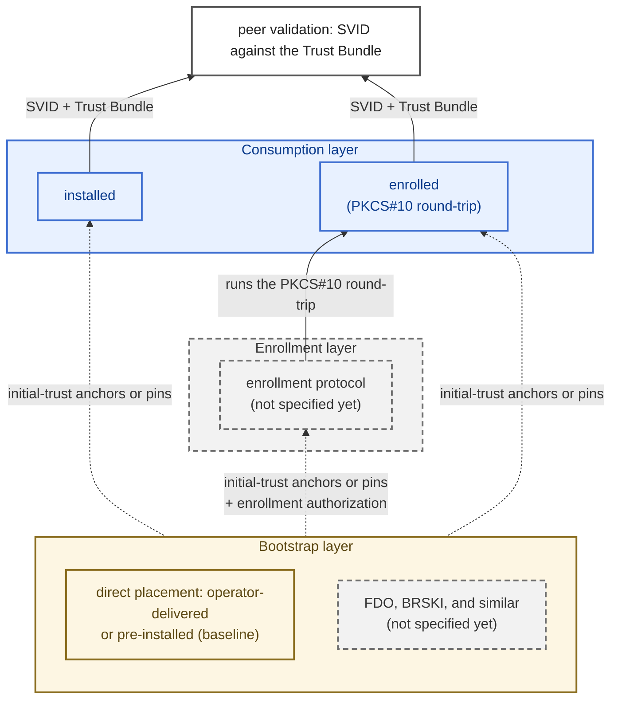

# Credential Provisioning and Acquisition

This section defines how a [principal](./identity-framework.md#terminology) obtains its X.509-SVID and trust material, and which provisioning inputs it must accept. It does not depend on an enrollment protocol.

It defines two things:

- **Two acquisition modes** ([Acquisition modes](#acquisition-modes)): **installed** (the operator generates the key and installs key and SVID) and **enrolled** (the principal generates its own key and is issued a certificate through a PKCS#10 round-trip). Each mode has a minimum that every implementation supports, so provisioning stays portable across vendors.
- **A provisioning input contract** ([Provisioning input contract](#provisioning-input-contract)): the inputs a principal must accept, with one interchange format for each, so any operator's PKI toolchain can provision any conformant product. How the inputs reach the principal is out of scope. That is the job of the operator's existing provisioning channel.

Two rules complete the contract: the [initial-trust anchors or pins](#initial-trust-anchors-and-pins), the only input that cannot itself be fetched, and [MIS independence](#mis-independence), which forbids a principal from requiring a specific [MIS](./identity-framework.md#the-mis-role) implementation.

The terms *acquisition mode*, *provisioning input*, *provisioning channel*, and *provisioning interface* are defined in the [MIAF terminology](./identity-framework.md#terminology).

## Scope

These rules apply to every MIAF principal that acquires an SVID and trust material. The [acquisition modes](#acquisition-modes), the [initial-trust anchors or pins](#initial-trust-anchors-and-pins), and [MIS independence](#mis-independence) apply to all principals alike. The [provisioning input contract](#provisioning-input-contract) lists the inputs common to all principals. Each identity profile adds the inputs specific to its *principal classes* (the kinds of principal the profile defines). For WFMs and WFM Clients, these are in the [WFM Identity Profile](./wfm-identity-profile.md#provisioning). The contract does not depend on which kind of Margo component a principal is. A principal class that a later profile introduces is provisioned under the same rules.

### Identity Layers (informative)

A Margo principal acquires and uses its identity across three layers. Different mechanisms can fill each layer, and the layer above does not depend on which one is chosen.

- **Consumption.** How the principal obtains its current SVID and Trust Bundle: the [acquisition modes](#acquisition-modes). This section defines this layer.
- **Enrollment.** What automates the round-trip of the enrolled mode over the wire. No enrollment profile is specified yet (see [lifecycle vocabulary (future work)](./identity-lifecycle.md#lifecycle-vocabulary)).
- **Bootstrap.** How the principal receives the inputs that the upper layers depend on: the [initial-trust anchors or pins](#initial-trust-anchors-and-pins) and, once an enrollment profile exists, its [enrollment authorization](#initial-trust-anchors-and-pins). The baseline is direct placement: the operator delivers the inputs through its provisioning channel, or they are pre-installed when the device or its software image is built. Protocols that produce these inputs at onboarding time from a manufacturer-installed credential (FDO, BRSKI, and similar) are not specified yet.

A deployment can pre-provision statically with neither enrollment nor automated bootstrap, add either, or combine all three layers. Only the consumption layer is normative in this release.

In the figure below, dotted edges are inputs delivered out of band. Blue marks what this section specifies, yellow the assumed baseline, and gray dashed boxes what is not specified yet.

## Acquisition Modes

A principal acquires two kinds of artifact: its own **SVID** (with private key) and the **Trust Bundle** it validates peers against. The acquisition modes differ in who generates and first holds the private key of the SVID. This determines what the operator supplies and how renewal works. The result is the same in both modes: the principal holds its current SVID and Trust Bundle, and peer validation consumes both without depending on which mode supplied them. Two acquisition modes are defined:

- **Installed.** The operator generates the key pair, mints the SVID, and places both into the principal through its provisioning channel. The principal does not renew on its own. Renewal happens by re-provisioning. This mode exists for principals that cannot generate keys safely (without an adequate entropy source, for example). Its cost is key custody concentrated in the operator (see [key handling](#key-handling)).
- **Enrolled.** The principal generates its own key pair, which never leaves it. Issuance is a CSR round-trip: the principal exports a PKCS#10 CSR, a CA in the Trust Domain signs it, and the principal ingests the returned chain. How the CSR travels is deliberately not fixed. An operator moving files by hand and an automated enrollment profile are the same mode at different levels of automation, because PKCS#10 is the interchange object that enrollment protocols carry natively.

These are the only conformant modes. A product cannot declare an acquisition path of its own: two individually conformant products could otherwise share no provisioning path at all. Only a later revision of this specification can add a mode.

The rules below follow the provisioning sequence: a product declares its modes, acquires its trust material, and runs the issuance round-trip.

### Declaring Acquisition Modes

A principal MUST implement at least one acquisition mode and MUST declare, in its product documentation, which of the two modes it implements. It MAY implement both. This framework mandates neither mode. A profile that builds on it can mandate one. A principal SHOULD prefer the enrolled mode over the installed mode where its hardware allows (see [key handling](#key-handling) for the reasons).

The product documentation MUST also state how the principal stores and protects its private key, for example in a TPM, in a secure element, or in software storage with named file permissions. MIAF sets no minimum key protection. The statement lets an operator or an integrator compare products and assess the result against their own security requirements.

### Trust Material

Every principal MUST accept a statically supplied Trust Bundle (in the [interchange format](#interchange-formats) for trust material). Every principal SHOULD also refresh it from `trustBundleUri`, over the [Trust Bundle retrieval endpoint](./trust-bundle-and-discovery.md#trust-bundle-retrieval-endpoint), per [selecting and refreshing the bundle](./trust-bundle-and-discovery.md#selecting-and-refreshing-the-bundle).

A principal that refreshes its Trust Bundle from `trustBundleUri` MUST accept `trustBundleUri` as a provisioning input, so that an operator can configure it without a discovery document. A principal that fetches MIS-hosted material MUST accept a discovery document URL, and MUST resolve from the retrieved [discovery document](./trust-bundle-and-discovery.md#discovery-document-endpoint) the fields it needs. The discovery document is the extension point of this framework. A later profile can add fields to it, and a principal that already accepts the URL needs no new provisioning input to reach them.

After an offline period, a principal SHOULD refresh promptly on reconnection, within the randomized delay in [selecting and refreshing the bundle](./trust-bundle-and-discovery.md#selecting-and-refreshing-the-bundle), so that a trust anchor rotation completed during its absence takes effect.

### Issuance by CSR

A principal that declares the enrolled mode MUST be able to export a PKCS#10 CSR for its generated key, and to ingest the certificate chain issued for it, both through the provisioning interface (see [provisioning input contract](#provisioning-input-contract)). This requirement also applies to a principal that automates enrollment, because the manual round-trip works with any operator's PKI toolchain.

The CSR carries the principal's public key and proof of possession. Any subject or SAN content in it is advisory. The issuer is authoritative for the SPIFFE ID: the operator mints the SVID for the chosen identity and overrides name content in the CSR. A principal is therefore issued its identity and does not request it (see [identifiers](#identifiers-and-trust-domain)). A renewal CSR MAY carry the principal's current SPIFFE ID. That content is advisory too.

### Chain Ingestion

On ingesting the returned chain, the principal MUST verify that the leaf certifies its own key pair, and that the leaf carries a well-formed SPIFFE ID whose structure matches an identity profile the principal implements. When it holds a Trust Bundle, it MUST additionally perform [RFC 5280](https://datatracker.ietf.org/doc/html/rfc5280) certification path validation of the chain to a trust anchor in that bundle. Failures surface as the validation rule for provisioning inputs requires.

## Provisioning Input Contract

A principal MUST accept the inputs below in the stated interchange formats, and MUST expose at least one **non-interactive, documented** provisioning interface for supplying them. The specific mechanism (file, mounted secret, environment, configuration API, or installer media) remains the vendor's choice. An operator can then check the requirement against the product's documentation. The specification does not dictate a deployment model.

A principal MUST validate provisioning inputs on ingestion and fail with a clear, distinguishable error on malformed material. An unrecognized local input SHOULD be surfaced as an error or warning, and not silently ignored. A mistyped input can otherwise disable or weaken the principal.

A principal SHOULD support replacing its SVID and trust material without a restart. A principal that must restart to replace its SVID remains conformant. [Session lifetime and re-validation](./tls-requirements.md#session-lifetime-and-re-validation) covers re-establishing connections after a client renews its SVID.

The provisioning interface can replace a principal's key, SVID, and trust anchors, so anyone who can use it can replace the principal's identity. The contract assumes that the provisioning interface is reachable only through the operator's provisioning channel. Access control on that channel is a deployment responsibility, and product hardening guidance SHOULD cover it.

### Interchange Formats

Each class of artifact has one interchange format:

| Artifact | Interchange format |
| :------- | :----------------- |
| Certificates | PEM ([RFC 7468](https://datatracker.ietf.org/doc/html/rfc7468)) |
| Private keys | unencrypted PKCS#8 ([RFC 5958](https://datatracker.ietf.org/doc/html/rfc5958)), PEM-encoded |
| CSRs | PKCS#10 ([RFC 2986](https://datatracker.ietf.org/doc/html/rfc2986)) |
| Trust material | SPIFFE bundle: a JWK Set per [RFC 7517](https://datatracker.ietf.org/doc/html/rfc7517), the container for the Trust Domain's X.509 trust anchors per [bundle contents and distribution](./trust-bundle-and-discovery.md#bundle-contents-and-distribution) (MIAF uses only `x509-svid` entries) |
| Identifiers that an identity profile defines | the format that the profile defines. For the [WFM Identity Profile](./wfm-identity-profile.md#identity-model) (`wfm-id`, `wfm-client-id`): [RFC 3986](https://datatracker.ietf.org/doc/html/rfc3986) unreserved strings, excluding `.` and `..` |
| Endpoints | absolute HTTPS URLs |
| Certificate pins | SPKI SHA-256 pins, in the form that [initial trust bootstrap](./tls-requirements.md#initial-trust-bootstrap) defines ([RFC 7469, Section 2.4](https://datatracker.ietf.org/doc/html/rfc7469#section-2.4)) |

### Inputs and Output for All Principals

The first table below states, for each input, when a conformant product must accept it. The second table states when a product must produce its only output, the PKCS#10 CSR.

| Input | Required | Notes |
| :---- | :------- | :---- |
| X.509-SVID + intermediate chain | always | the principal's own SVID with its chain, per the [X.509-SVID profile](./svids.md#x509-svid-profile) |
| Private key (only when operator-supplied) | installed mode only | see [key handling](#key-handling) |
| Initial-trust anchors | where the principal fetches MIS-hosted material ([initial-trust anchors or pins](#initial-trust-anchors-and-pins)) | one or more certificates. The principal validates the MIS server chain to these anchors, with [RFC 9525](https://datatracker.ietf.org/doc/html/rfc9525) name checks |
| Initial-trust pins | where the principal fetches MIS-hosted material ([initial-trust anchors or pins](#initial-trust-anchors-and-pins)) | a pin set. The pin itself establishes server identity, with no DNS name required, so it also fits MIS endpoints reached by IP address |
| Trust Bundle, static | always ([trust material](#trust-material)) | the anchors of the principal's own Trust Domain, as a SPIFFE bundle |
| `trustBundleUri` | where refresh is implemented ([trust material](#trust-material)) | the URL the principal refreshes the Trust Bundle from |
| Discovery document URL | where the principal fetches MIS-hosted material ([trust material](#trust-material)) | resolves `trustBundleUri`, and the fields a later profile adds |

| Output | Required | Notes |
| :----- | :------- | :---- |
| PKCS#10 CSR | enrolled mode only ([issuance by CSR](#issuance-by-csr)) | the principal exports it for signing through the provisioning interface |

### Key Handling

The operator-supplied key uses the interchange format unencrypted PKCS#8 PEM. Confidentiality on the key path is the job of the provisioning channel, and passphrase handling would otherwise become a provisioning input of its own.

The enrolled mode is recommended (see [declaring acquisition modes](#declaring-acquisition-modes)) for two reasons:

- The key is generated on the principal and never leaves it. Hardware-backed storage (TPM, secure element, HSM) can make it non-exportable.
- The enrollment profile planned in [lifecycle vocabulary (future work)](./identity-lifecycle.md#lifecycle-vocabulary) is expected to automate only this mode, so renewal at fleet scale depends on it.

Key generation and CSR signatures follow the [cryptographic requirements](./svids.md#cryptographic-requirements). An operator SHOULD deliver an operator-generated key over a channel that authenticates both ends and encrypts in transit, or wrapped for the receiving principal. This is guidance to the operator and adds no conformance requirement on the principal.

### Identifiers and Trust Domain

No provisioning input gives the principal its own identity or Trust Domain. That is deliberate:

- **Identifiers come from the SVID.** A principal never needs to be told its own SPIFFE ID in advance. It reads it from the URI SAN of its issued SVID. The Trust Domain is part of that SPIFFE ID. An identity profile can derive further identifiers from the same SVID (see [WFM Identity Profile provisioning](./wfm-identity-profile.md#provisioning)).
- **Trust Domain and bundle.** A single SPIFFE bundle does not name the domain it anchors, so a principal treats the bundle it holds as the authoritative anchors of its own Trust Domain.

## Initial-Trust Anchors and Pins

Wherever a principal fetches MIS-hosted material over HTTPS, it authenticates each retrieval with its initial-trust anchors or pins (see [initial trust bootstrap](./tls-requirements.md#initial-trust-bootstrap)). The first retrieval happens before the principal holds anything MIAF-issued, so this material cannot be acquired through the contract. It is therefore a static input, except in the public PKI case below. A principal provisioned entirely out of band makes no such retrieval and needs no initial-trust anchors or pins. The rules for initial trust bootstrap define the mechanisms and the client-side validation. This section names their material as a provisioning input and adds its lifecycle.

The initial-trust anchors or pins are server-authentication material: they let the principal trust the MIS it fetches from. They are distinct from an *enrollment authorization*, which proves that the principal is *authorized* to receive an SVID. An enrollment profile is expected to add an enrollment authorization as a second static bootstrap input beside them. Both are delivered over the same out-of-band channel, and the precondition below covers both.

### Precondition

This contract assumes that the operator has an out-of-band channel that reaches each principal *before its first connection*. Without such a channel, no provisioning is possible under this contract. Automated bootstrap mechanisms for that case are not specified yet (see [lifecycle vocabulary (future work)](./identity-lifecycle.md#lifecycle-vocabulary)). This precondition MUST be stated in any deployment guidance derived from this specification.

Any mechanism that delivers these inputs before the first connection can fill this channel. This specification fills it with direct operator delivery. Automated mechanisms can fill it later without any change to this contract.

### Choosing Anchors or Pins

A principal that fetches MIS-hosted material MUST accept both interchange forms: an anchor set and a pin set (see [interchange formats](#interchange-formats)). The operator chooses between them.

Where the MIS server certificates validate to the principal's built-in trust store, with a resolvable DNS name for the [RFC 9525](https://datatracker.ietf.org/doc/html/rfc9525) name check, that trust store provides the initial-trust anchors, and the operator provisions only the endpoint URL. This specification does not recommend exposing an MIS on public PKI where it would not otherwise be. In every other case (a private or enterprise PKI, for example), the operator MUST provision an anchor set or a pin set out of band.

Operators SHOULD pin the SubjectPublicKeyInfo of a CA instead of a leaf certificate, and SHOULD pin a CA that certifies only the MIS endpoints. A principal SHOULD validate the endpoint identity per [RFC 9525](https://datatracker.ietf.org/doc/html/rfc9525) even when a pin matches. For an endpoint reached by DNS name, [certificate validation](./tls-requirements.md#certificate-validation) already requires this check. A leaf pin breaks on routine certificate renewal. A broad CA pin lets any holder of certificates from that CA impersonate the MIS.

### Replacing Anchors and Pins

The initial-trust anchors or pins SHOULD be independent of, and longer-lived than, the SVID-issuing authority, so that routine rotation of the issuing CA never forces their re-provisioning. A successor anchor or pin SHOULD be pre-distributed through the channel that the current anchors or pins still authenticate, before the current anchors, or the CA certificates the pins identify, expire.

Lapsed or compromised initial-trust anchors or pins cannot be recovered in band, because they no longer authenticate the channel that would deliver their replacement. Operators MUST treat that recovery as a planned out-of-band re-provisioning event.

## MIS Independence

MIAF defines the MIS as a [role](./identity-framework.md#the-mis-role), not a specific service, and lists what can fill it. The rules below keep that true on the product side:

- A principal MUST NOT require a specific MIS implementation. Concretely, it MUST NOT condition validation on a particular issuer or vendor trust root, and it MUST NOT depend on one vendor's issuance or delivery service to obtain its SVID. It MUST be able to acquire and validate SVIDs issued by any conformant MIS, through the modes it declares.
- A principal MUST NOT hardwire its own or its vendor's trust anchor as the sole accepted anchor. Accepted anchors come from the Trust Bundle. The [initial-trust anchors or pins](#initial-trust-anchors-and-pins) are not such hardwired anchors: the operator configures them for each deployment, so the same product works with a different MIS in each Trust Domain.
- A vendor MAY bundle an MIS as a convenience, provided it is an optional, swappable component with a documented path to an operator-supplied issuer. A bundled MIS MUST NOT be a precondition for the operation of the principal.

MIS independence does not require implementing more than one acquisition mode. Declaring a single mode is permitted, because both modes have an MIS-neutral path by construction: the inputs of the installed mode and the CSR round-trip of the enrolled mode work with any operator's PKI toolchain.
